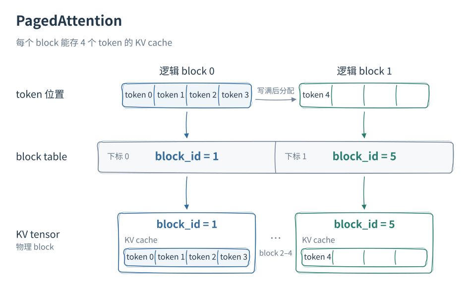
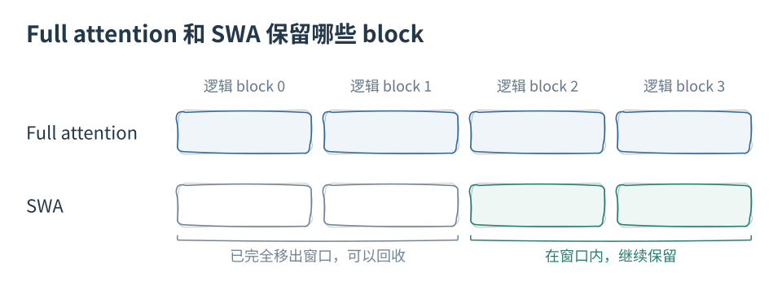
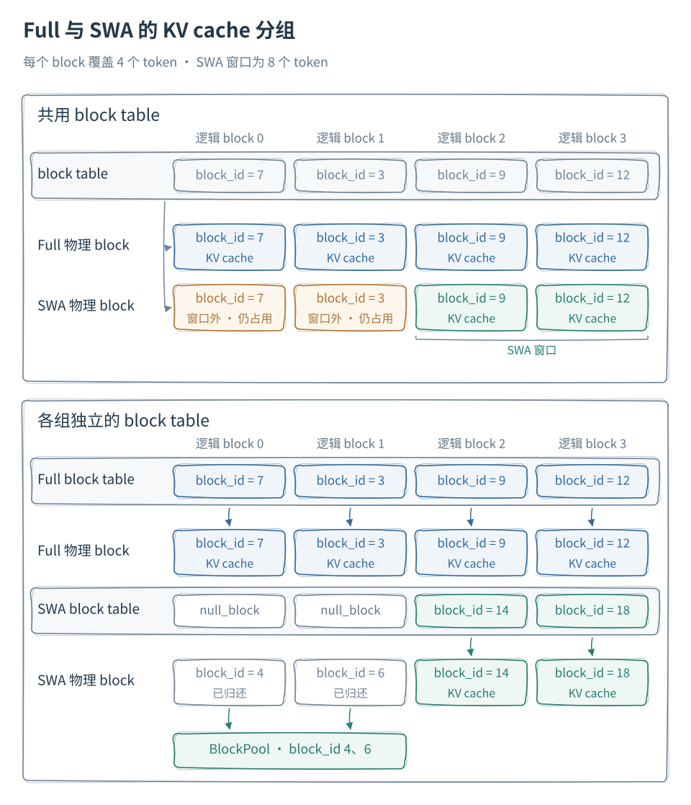
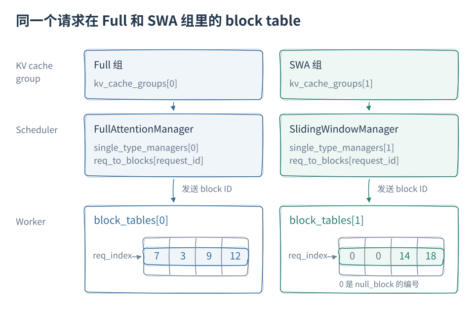
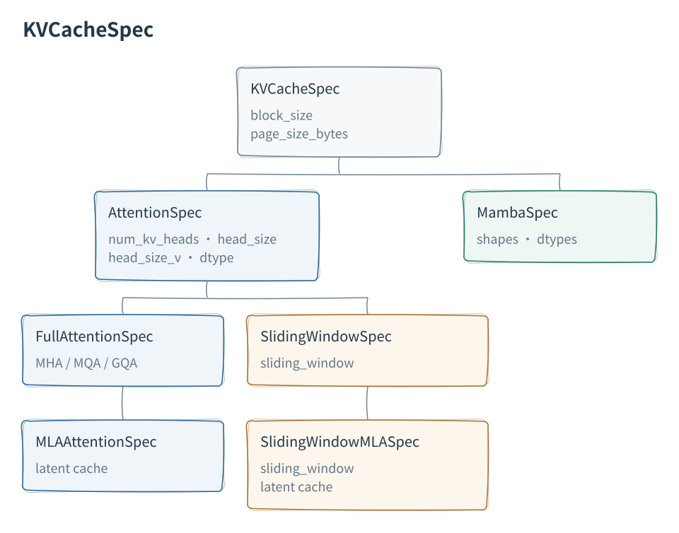
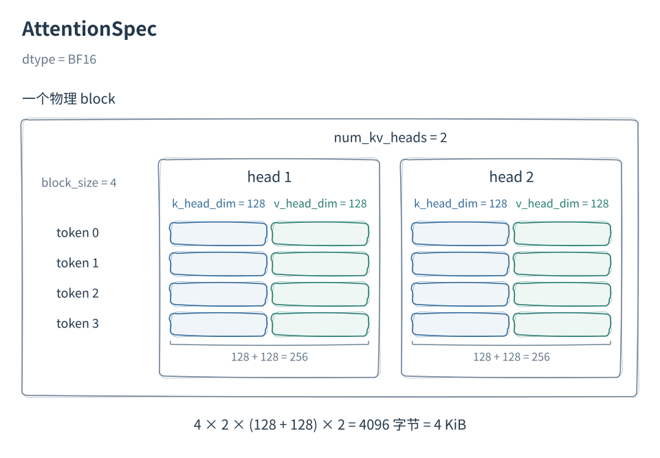
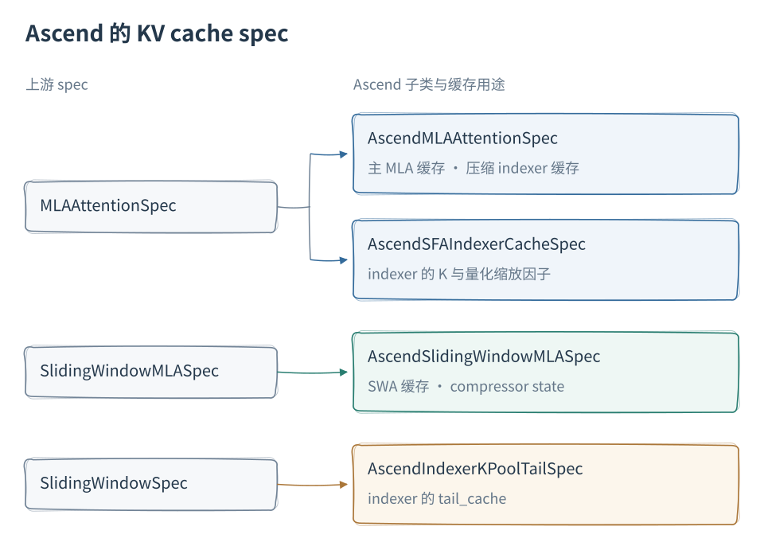
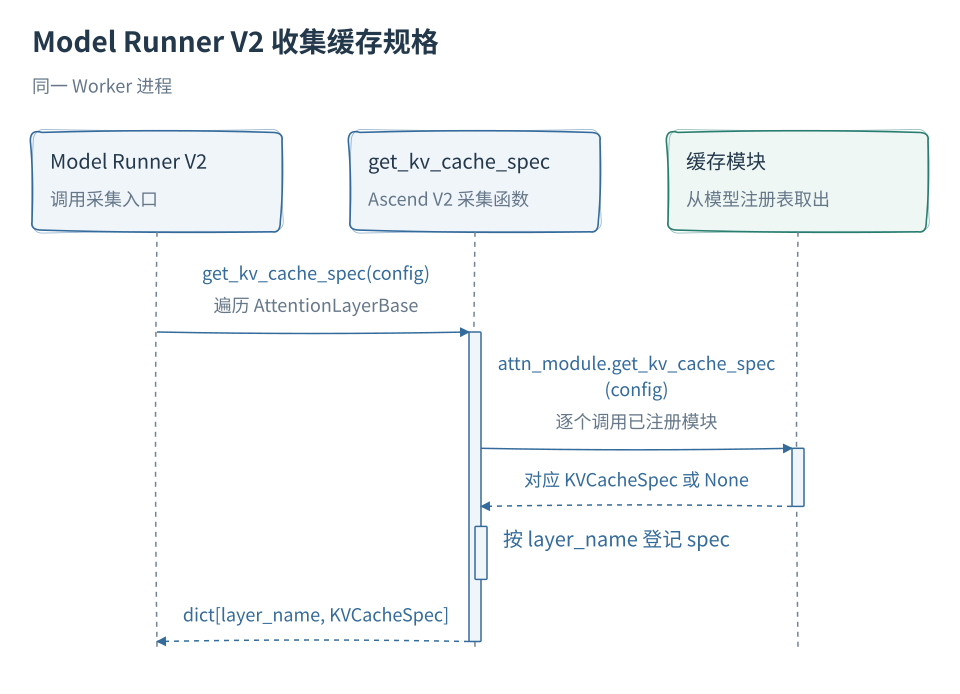

# 为什么要给 KV cache 分组

## PagedAttention

PagedAttention 按 block 给 KV cache 分配内存。图里每个 block 有 4 个位置，前四个 token 的 KV cache 填满了物理 block `1`。处理位置 `4` 时，vLLM 从 `BlockPool` 取到物理 block `5`，这个请求的 `block table` 从 `[1]` 变成 `[1, 5]`。



token `4` 属于逻辑 block `1`，从 `block_table[1]` 查到的物理 block 编号是 `5`。它的 KV cache 就在 KV tensor 的 block `5` 中读写。图中物理 block `1` 和 `5` 之间的几块还可以分给别的请求。[vLLM 官方 PagedAttention 介绍](https://vllm.ai/blog/2023-06-20-vllm)

## 为什么一张 block table 不够

Full attention 计算新 token 时要读之前所有 token 的 KV cache，所以旧 block 要留到请求结束。SWA（sliding window attention）只需要窗口内的 KV cache，已经完全移出窗口的 block 可以回收。[SWA 的窗口](https://github.com/vllm-project/vllm/blob/4ba787ec9959e566d3b587a796dff07673324da5/vllm/v1/core/single_type_kv_cache_manager.py#L1148-L1165) · [窗口外的 block 回收](https://github.com/vllm-project/vllm/blob/4ba787ec9959e566d3b587a796dff07673324da5/vllm/v1/core/single_type_kv_cache_manager.py#L704-L720)



如果 Full 和 SWA 共用一张 `block table`，旧 block 就得按 Full 的需要留着，SWA 已经用完的空间也会一起占着。vLLM 把 Full 和 SWA 的 KV cache 分到不同的 **KV cache group**，各组用自己的 `block table`。窗口往前移时，SWA 就可以单独回收旧 block。[KVCacheGroupSpec](https://github.com/vllm-project/vllm/blob/4ba787ec9959e566d3b587a796dff07673324da5/vllm/v1/kv_cache_interface.py#L1505-L1513)



SWA 归还 block `4` 和 `6` 后，调度侧在原来的两个位置用 `null_block` 占位。Full 继续用 block `7` 和 `3` 读历史 KV cache。[占位并归还 block](https://github.com/vllm-project/vllm/blob/4ba787ec9959e566d3b587a796dff07673324da5/vllm/v1/core/single_type_kv_cache_manager.py#L670-L680)

### 每组一个 manager、一张 block table

Scheduler 给 Full 和 SWA 两组各建一个 manager，负责本组的 block 分配和回收。Worker 也给两组各建一张 `block table`。图里 Full 是第 `0` 组，SWA 是第 `1` 组。[创建 manager](https://github.com/vllm-project/vllm/blob/4ba787ec9959e566d3b587a796dff07673324da5/vllm/v1/core/kv_cache_coordinator.py#L161-L176) · [按组建表](https://github.com/vllm-project/vllm/blob/4ba787ec9959e566d3b587a796dff07673324da5/vllm/v1/worker/gpu/block_table.py#L65-L75)



## KVCacheSpec

`KVCacheSpec` 是缓存规格的基类。Full、SWA、MLA、Mamba 等缓存使用不同的子类。

### attention 对应的 spec



| spec | 用途 | 核心字段 |
| --- | --- | --- |
| `FullAttentionSpec` | MHA / MQA / GQA | K、V 的头数 `num_kv_heads`，每个头的 K、V 维度 `head_size`、`head_size_v`，数据格式 `dtype` [定义](https://github.com/vllm-project/vllm/blob/4ba787ec9959e566d3b587a796dff07673324da5/vllm/v1/kv_cache_interface.py#L618-L639) |
| `MLAAttentionSpec` | MLA、MLA 格式的压缩缓存 | 缓存向量维度 `head_size`，每个向量对应的 token 数 `tokens_per_state`，数据格式 `dtype` [定义](https://github.com/vllm-project/vllm/blob/4ba787ec9959e566d3b587a796dff07673324da5/vllm/v1/kv_cache_interface.py#L728-L743) |
| `SlidingWindowSpec` | SWA | 窗口长度 `sliding_window` [定义](https://github.com/vllm-project/vllm/blob/4ba787ec9959e566d3b587a796dff07673324da5/vllm/v1/kv_cache_interface.py#L900-L908) |
| `SlidingWindowMLASpec` | MLA 窗口缓存 | 窗口长度 `sliding_window`，缓存向量维度 `head_size`，数据格式 `dtype` [定义](https://github.com/vllm-project/vllm/blob/4ba787ec9959e566d3b587a796dff07673324da5/vllm/v1/kv_cache_interface.py#L1007-L1018) |
| `CircularBufferSpec` | 压缩模块的 raw key ring | 循环缓存容量 `block_size`，每请求一个 block，前缀复用 `prefix_cacheable=False` [定义](https://github.com/vllm-project/vllm/blob/4ba787ec9959e566d3b587a796dff07673324da5/vllm/v1/kv_cache_interface.py#L967-L1000) |
| `MambaSpec` | Mamba、GDN、KDA | 状态形状 `shapes`，数据格式 `dtypes`，缓存模式 `mamba_cache_mode` [定义](https://github.com/vllm-project/vllm/blob/4ba787ec9959e566d3b587a796dff07673324da5/vllm/v1/kv_cache_interface.py#L1093-L1107) |

### 核心字段

```python
class KVCacheSpec:
    """A base class for specifying the KV cache format of one layer."""

    # number of tokens in a block
    block_size: int
    # ...
class AttentionSpec(KVCacheSpec):
    # ...
    num_kv_heads: int
    head_size: int
    dtype: torch.dtype
    head_size_v: int = None  # type: ignore[assignment]
```

源码片段 [kv_cache_interface.py L202–206](https://github.com/vllm-project/vllm/blob/4ba787ec9959e566d3b587a796dff07673324da5/vllm/v1/kv_cache_interface.py#L202-L206) · [kv_cache_interface.py L552](https://github.com/vllm-project/vllm/blob/4ba787ec9959e566d3b587a796dff07673324da5/vllm/v1/kv_cache_interface.py#L552-L552) · [kv_cache_interface.py L557–560](https://github.com/vllm-project/vllm/blob/4ba787ec9959e566d3b587a796dff07673324da5/vllm/v1/kv_cache_interface.py#L557-L560)

| 属性 | 含义 |
| --- | --- |
| `block_size` | 一个完整 block 覆盖的 token 数 |
| `num_kv_heads` | 当前 Worker 持有的 KV 头数 |
| `head_size`、`head_size_v` | 普通 K/V 缓存中，每个头的 K、V 元素数 |
| `dtype` | 元素类型，BF16 每个元素占 2 字节 |
| `tokens_per_state` | 每条记录覆盖的 token 数，`1` 表示一 token 一条记录，`4` 表示四 token 压缩成一条记录缓存 |
| `page_size_padded` | 指定 block 补齐到多少字节，默认 `None`（不补齐） |
| `page_size_bytes` | 一个 block 最终分配的字节数 |

[公共字段](https://github.com/vllm-project/vllm/blob/4ba787ec9959e566d3b587a796dff07673324da5/vllm/v1/kv_cache_interface.py#L551-L572) · [字节数计算](https://github.com/vllm-project/vllm/blob/4ba787ec9959e566d3b587a796dff07673324da5/vllm/v1/kv_cache_interface.py#L579-L601)

### 一个物理 block 占多少空间



图中一个 token 的 KV cache 占 `2 × (128 + 128) × 2 = 1024` 字节，四个 token 占 `4096` 字节（`4 KiB`）。[计算代码](https://github.com/vllm-project/vllm/blob/4ba787ec9959e566d3b587a796dff07673324da5/vllm/v1/kv_cache_interface.py#L579-L594)

```text
block_size × num_kv_heads × (head_size + head_size_v) × 每个元素的字节数
```

图中的 KV cache 占 `4096` 字节。如果设置 `page_size_padded=8192`，一个 block 就分配 `8192` 字节，多出的 `4096` 字节是 padding。[大小计算](https://github.com/vllm-project/vllm/blob/4ba787ec9959e566d3b587a796dff07673324da5/vllm/v1/kv_cache_interface.py#L592-L601)

| `page_size_padded` | `page_size_bytes` |
| --- | --- |
| `None`（不补齐） | `4096` 字节 |
| `8192` | `8192` 字节 |

MLA 和 Mamba 缓存按各自的 spec 计算。[Mamba 状态大小](https://github.com/vllm-project/vllm/blob/4ba787ec9959e566d3b587a796dff07673324da5/vllm/v1/kv_cache_interface.py#L1109-L1129)

### Ascend 的 spec

Ascend 的子类沿用上游 spec 中的 `block_size`、`head_size`、`dtype` 等属性。各子类按用途增加属性，例如量化参数 `scale_dim`、`scale_dtype`，压缩比 `compress_ratio`，以及布局标记 `indexes_kv_by_block_stride`。部分子类还重写了 block 字节数的计算属性，如 `real_page_size_bytes`、`unpadded_page_size_bytes` 和 `page_size_bytes`。[MLA 实现](https://github.com/vllm-project/vllm-ascend/blob/7844c213dc4ee84f24b21471466ce2f25196626a/vllm_ascend/core/kv_cache_interface.py#L244-L254) · [indexer 实现](https://github.com/vllm-project/vllm-ascend/blob/7844c213dc4ee84f24b21471466ce2f25196626a/vllm_ascend/core/kv_cache_interface.py#L348-L355)



类定义 [MLA](https://github.com/vllm-project/vllm-ascend/blob/7844c213dc4ee84f24b21471466ce2f25196626a/vllm_ascend/core/kv_cache_interface.py#L191-L217) · [indexer](https://github.com/vllm-project/vllm-ascend/blob/7844c213dc4ee84f24b21471466ce2f25196626a/vllm_ascend/core/kv_cache_interface.py#L313-L329) · [SWA](https://github.com/vllm-project/vllm-ascend/blob/7844c213dc4ee84f24b21471466ce2f25196626a/vllm_ascend/core/kv_cache_interface.py#L391-L401) · [tail](https://github.com/vllm-project/vllm-ascend/blob/7844c213dc4ee84f24b21471466ce2f25196626a/vllm_ascend/core/kv_cache_interface.py#L473-L495)

## Worker 收集 KVCacheSpec

Model Runner V2 遍历模型注册的缓存模块，调用各模块的 `get_kv_cache_spec()`。复用其他模块缓存的模块会被跳过，返回 `None` 的也不登记。[查找缓存模块](https://github.com/vllm-project/vllm/blob/4ba787ec9959e566d3b587a796dff07673324da5/vllm/config/vllm.py#L3640-L3661) · [遍历与采集](https://github.com/vllm-project/vllm-ascend/blob/7844c213dc4ee84f24b21471466ce2f25196626a/vllm_ascend/worker/v2/attn_utils.py#L201-L221)



```python
def get_kv_cache_spec(vllm_config: VllmConfig) -> dict[str, KVCacheSpec]:
    # ...
    kv_cache_spec: dict[str, KVCacheSpec] = {}
    # ...
    layer_type = AttentionLayerBase
    attn_layers = get_layers_from_vllm_config(vllm_config, layer_type)
    for layer_name, attn_module in attn_layers.items():
        if getattr(attn_module, "kv_sharing_target_layer_name", None):
            continue

        spec = attn_module.get_kv_cache_spec(vllm_config)
        # ...
        if spec is None:
            continue
        # ...
        kv_cache_spec[layer_name] = spec
    # ...
    return kv_cache_spec
```

源码片段 [函数签名](https://github.com/vllm-project/vllm-ascend/blob/7844c213dc4ee84f24b21471466ce2f25196626a/vllm_ascend/worker/v2/attn_utils.py#L196-L196) · [spec 字典](https://github.com/vllm-project/vllm-ascend/blob/7844c213dc4ee84f24b21471466ce2f25196626a/vllm_ascend/worker/v2/attn_utils.py#L198-L198) · [遍历并读取 spec](https://github.com/vllm-project/vllm-ascend/blob/7844c213dc4ee84f24b21471466ce2f25196626a/vllm_ascend/worker/v2/attn_utils.py#L201-L207) · [跳过空 spec](https://github.com/vllm-project/vllm-ascend/blob/7844c213dc4ee84f24b21471466ce2f25196626a/vllm_ascend/worker/v2/attn_utils.py#L220-L221) · [按 layer_name 保存](https://github.com/vllm-project/vllm-ascend/blob/7844c213dc4ee84f24b21471466ce2f25196626a/vllm_ascend/worker/v2/attn_utils.py#L250-L250) · [返回字典](https://github.com/vllm-project/vllm-ascend/blob/7844c213dc4ee84f24b21471466ce2f25196626a/vllm_ascend/worker/v2/attn_utils.py#L307-L307)

### cache entry

Worker 返回一个字典，键是 `layer_name`，值是对应的 `KVCacheSpec`。字典里的每一项就是一条 cache entry。
