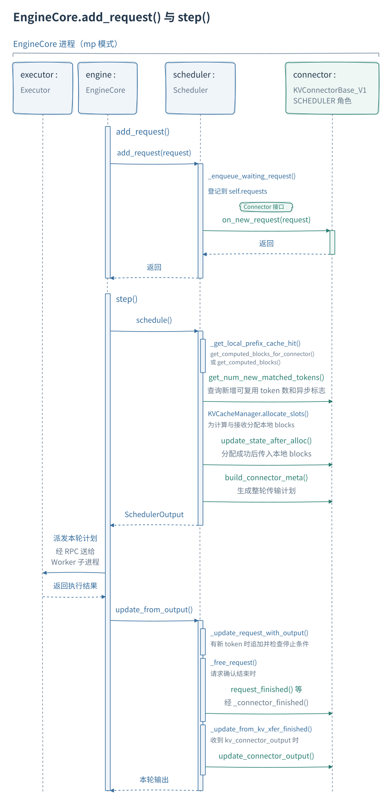
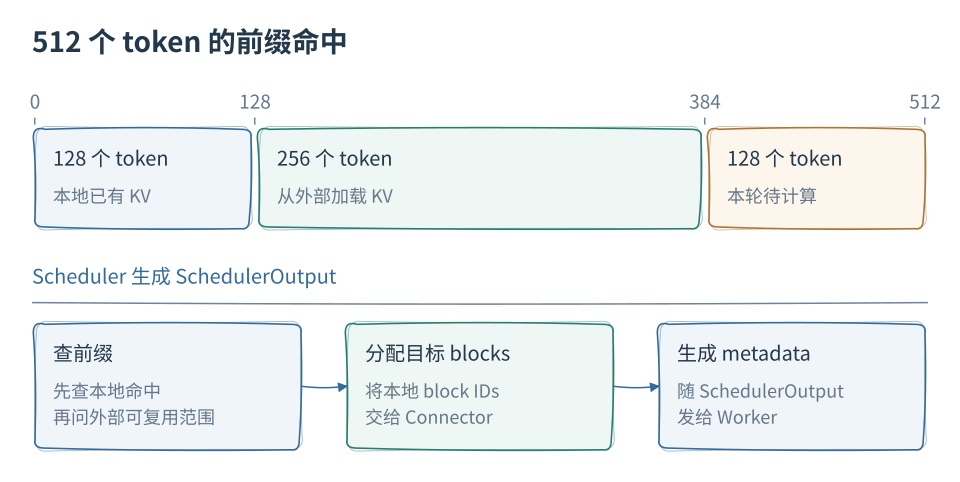
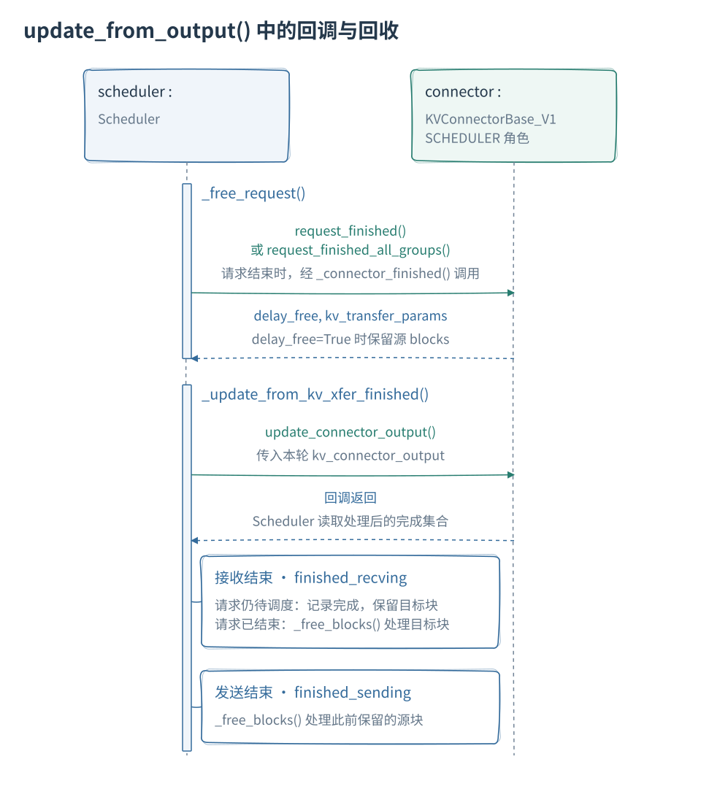

# vLLM 请求调度（一）：Scheduler 与 KV Connector

假设一个请求有 512 个 prompt token。本地已有前 128 个 token 的 KV，外部缓存还能补上接下来的 256 个。即使这轮只需计算最后 128 个 token，Scheduler 也得先给要搬进来的 KV 留出 blocks。还要等数据到位，attention 才能读取它。



- **EngineCore 进程**里，`engine` 是一个 `EngineCore` 实例，一轮执行从它的 `step()` 开始。它先调用 Scheduler（`self.scheduler`）生成计划，再通过 Executor（`self.model_executor`）把计划发给 Worker。收到 `ModelRunnerOutput` 后，它把结果交回 Scheduler 更新状态。启用 KV 传输时，Scheduler 会创建调度侧 Connector（`SCHEDULER` 角色），保存在 `self.connector` 中。[EngineCore.step() 源码](https://github.com/vllm-project/vllm/blob/v0.30.0/vllm/v1/engine/core.py#L589-L619) · [EngineCore 初始化](https://github.com/vllm-project/vllm/blob/v0.30.0/vllm/v1/engine/core.py#L133-L170) · [Scheduler 创建 Connector](https://github.com/vllm-project/vllm/blob/v0.30.0/vllm/v1/core/sched/scheduler.py#L140-L159)
- **Worker 子进程**通过消息队列接收 Executor 发来的 `SchedulerOutput`，其中有本轮的 token 计划、block IDs 和传输计划。执行结果再经 Executor 返回。[跨进程派发源码](https://github.com/vllm-project/vllm/blob/v0.30.0/vllm/v1/executor/multiproc_executor.py#L340-L448) · [第二篇的 Worker 执行路径](02-runner-v2.html)

## schedule：先查前缀，再分配 blocks

`schedule()` 先进入 `_get_local_prefix_cache_hit()`，调用 `KVCacheManager` 的 `get_computed_blocks_for_connector()` 或 `get_computed_blocks()` 查本地前缀。Scheduler 再用 `connector.get_num_new_matched_tokens()` 问外部还能补多少。外部 KV 可以来自 AscendStore，也可以来自 P/D 分离中的 Prefill 实例。[本地查询入口](https://github.com/vllm-project/vllm/blob/v0.30.0/vllm/v1/core/sched/scheduler.py#L528-L538) · [两次查询的顺序](https://github.com/vllm-project/vllm/blob/v0.30.0/vllm/v1/core/sched/scheduler.py#L917-L940)



Scheduler 用 `KVCacheManager.allocate_slots()` 分配本地 blocks，成功后才调用 `update_state_after_alloc()` 把目标 blocks 交给 Connector。等整轮计划排完，`build_connector_meta()` 把接收或保存任务写入 `SchedulerOutput.kv_connector_metadata`。例如 Mooncake Pull 在 Decode 端走异步接收，请求会进入 `WAITING_FOR_REMOTE_KVS`，这轮先把接收任务交给 Worker。[分配后的回调与异步分支](https://github.com/vllm-project/vllm/blob/v0.30.0/vllm/v1/core/sched/scheduler.py#L1159-L1239) · [生成 metadata](https://github.com/vllm-project/vllm/blob/v0.30.0/vllm/v1/core/sched/scheduler.py#L1433-L1461)

## update_from_output：处理 Connector 的完成通知

在 Mooncake Pull 中，P 端生成结束后，D 端还可能在读 P 端的 KV。Scheduler 会先问 Connector 是否要保留源 blocks，再在 `update_from_output()` 里处理收发完成通知。[`Scheduler._free_request()`](https://github.com/vllm-project/vllm/blob/v0.30.0/vllm/v1/core/sched/scheduler.py#L2561-L2588) · [处理 `kv_connector_output`](https://github.com/vllm-project/vllm/blob/v0.30.0/vllm/v1/core/sched/scheduler.py#L2213-L2215)



生成到停止条件时，`update_from_output()` 已经拿到了本轮的模型结果，再调用 `_free_request()`。客户端取消请求时，`finish_requests()` 也会调用 `_free_request()`。[`Scheduler.update_from_output()`](https://github.com/vllm-project/vllm/blob/v0.30.0/vllm/v1/core/sched/scheduler.py#L2117-L2124) · [`Scheduler.finish_requests()`](https://github.com/vllm-project/vllm/blob/v0.30.0/vllm/v1/core/sched/scheduler.py#L2546-L2557)

`_free_request()` 经 `_connector_finished()` 调用调度侧 Connector 的 `request_finished()` 或 `request_finished_all_groups()`。Connector 返回 `delay_free=True` 时，Scheduler 继续保留源 blocks。如果请求无需为传输暂留 blocks，`_free_request()` 就调用 `_free_blocks()`。[`Scheduler._connector_finished()`](https://github.com/vllm-project/vllm/blob/v0.30.0/vllm/v1/core/sched/scheduler.py#L2871-L2896)

`_update_from_kv_xfer_finished()` 先把 `kv_connector_output` 交给 Connector 处理，再从同一个对象读取接收和发送的完成通知。[`Scheduler._update_from_kv_xfer_finished()`](https://github.com/vllm-project/vllm/blob/v0.30.0/vllm/v1/core/sched/scheduler.py#L2998-L3025)

```python
if self.connector is not None:
    self.connector.update_connector_output(kv_connector_output)

for req_id in kv_connector_output.finished_recving or ():
    req = self.requests[req_id]
    if req.status == RequestStatus.WAITING_FOR_REMOTE_KVS:
        self.finished_recving_kv_req_ids.add(req_id)
    else:
        assert RequestStatus.is_finished(req.status)
        self._free_blocks(self.requests[req_id])

for req_id in kv_connector_output.finished_sending or ():
    self._free_blocks(self.requests[req_id])
```

- **`finished_recving` 表示外部 KV 接收结束。** 请求还要继续执行时，Scheduler 把请求 ID 加入 `finished_recving_kv_req_ids`。后续 `schedule()` 轮到该请求时，看到它已在集合里，就解除等待远端 KV 的状态，让请求继续参与调度。若请求已在接收途中取消，这条通知表示 Connector 已用完目标 blocks，此时调用 `_free_blocks()`。[`Scheduler._try_promote_blocked_waiting_request()`](https://github.com/vllm-project/vllm/blob/v0.30.0/vllm/v1/core/sched/scheduler.py#L2962-L2977) · [取消时暂留目标 blocks](https://github.com/vllm-project/vllm/blob/v0.30.0/vllm/v1/core/sched/scheduler.py#L2546-L2557)
- **`finished_sending` 表示 Connector 可以交回源 blocks。** Scheduler 调用 `_free_blocks()` 处理此前为传输保留的源 blocks。以 Mooncake Pull 为例，Decode 端结束接收后会发确认，Prefill 侧的 `update_connector_output()` 把对应请求 ID 写进 `finished_sending`。[`MooncakePullConnectorScheduler.update_connector_output()`](https://github.com/vllm-project/vllm-ascend/blob/v0.30.0/vllm_ascend/distributed/kv_transfer/kv_p2p/mooncake/pull_scheduler.py#L724-L759)

`_free_blocks()` 将释放 blocks 的工作交给 `_free_request_blocks()`，随后删除请求记录。[`Scheduler._free_blocks()`](https://github.com/vllm-project/vllm/blob/v0.30.0/vllm/v1/core/sched/scheduler.py#L2590-L2593)
