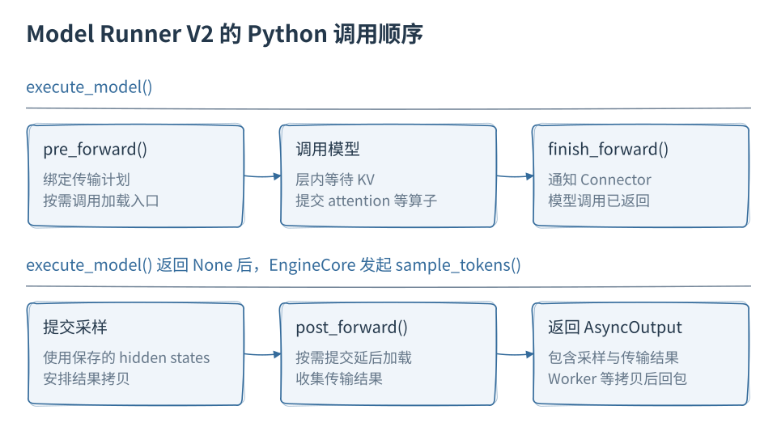
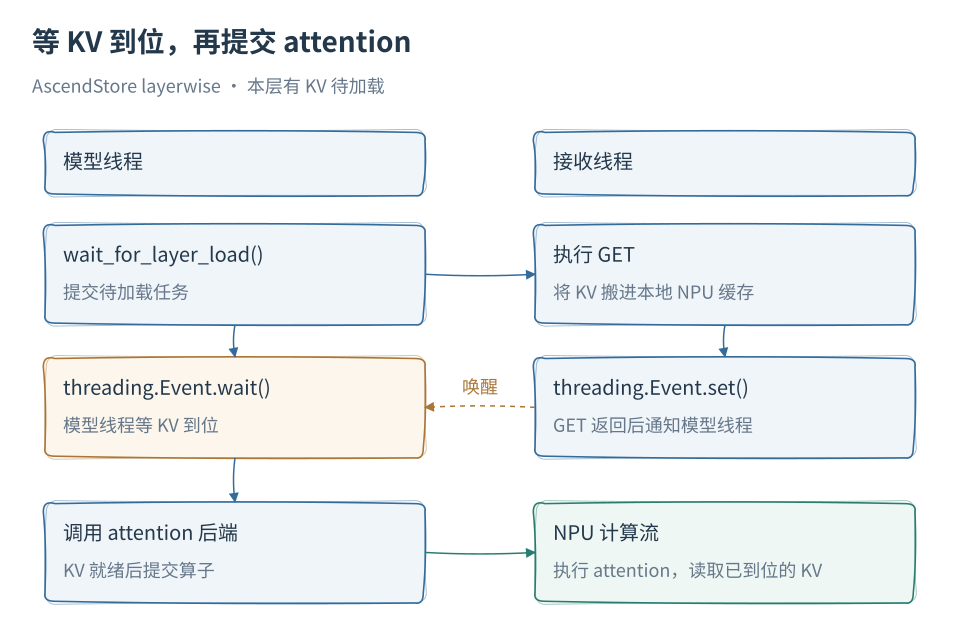
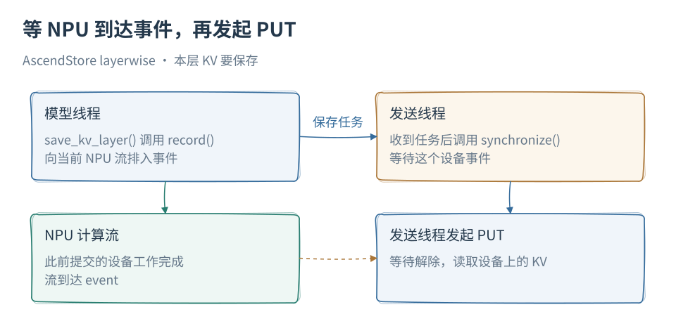
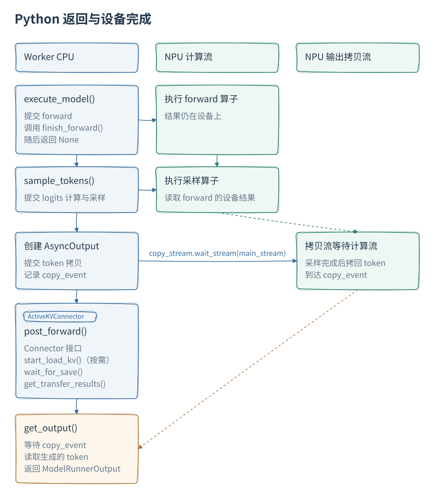
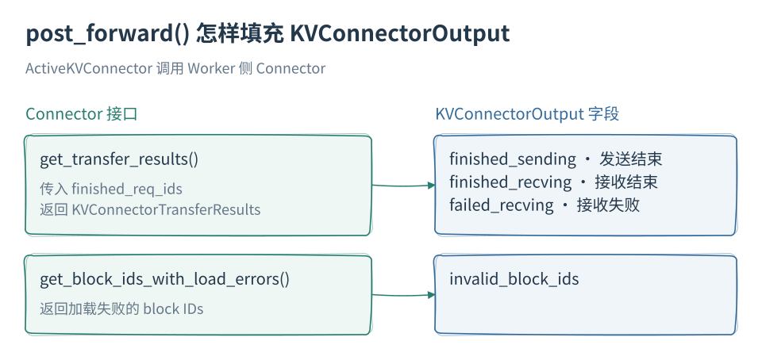
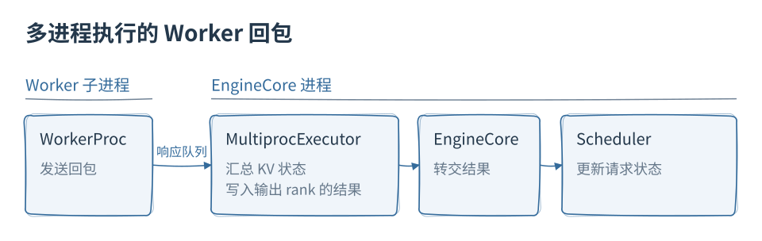

# vLLM 请求调度（二）：Model Runner V2 的 KV 加载与保存

Worker 收到 `SchedulerOutput` 后，`NPUWorker` 把本轮计划交给 Model Runner V2（`self.model_runner`）。启用 KV 传输时，Runner 通过 `ActiveKVConnector` 调用本进程中 `WORKER` 角色的 Connector。[NPUWorker 创建 Runner](https://github.com/vllm-project/vllm-ascend/blob/v0.30.0/vllm_ascend/worker/worker.py#L509-L514) · [ActiveKVConnector 取得 Worker 侧实例](https://github.com/vllm-project/vllm/blob/v0.30.0/vllm/v1/worker/gpu/kv_connector.py#L53-L61)



## forward 前，什么时候启动加载

Runner 调用 `pre_forward()`，通过 `ActiveKVConnector` 把调度计划绑定到 Worker 侧 Connector。`has_sync_kv_loads` 是本轮的标志。

- **`True`** 表示本轮有计算依赖外部 KV，Model Runner V2 在 forward 前调用 Connector 的 `start_load_kv()`。
- **`False`** 时，Runner 暂存调用参数，到 `post_forward()` 再调用加载入口。比如 Mooncake Pull 这时可以把异步接收任务交给后台线程。实际有多少数据要搬，由本轮计划决定。

[Runner 的加载分支](https://github.com/vllm-project/vllm/blob/v0.30.0/vllm/v1/worker/gpu/kv_connector.py#L66-L91) · [Mooncake Pull 提交接收任务](https://github.com/vllm-project/vllm-ascend/blob/v0.30.0/vllm_ascend/distributed/kv_transfer/kv_p2p/mooncake/pull_worker.py#L1588-L1600)

## 一层 attention，谁在等谁

attention 的 Python wrapper 在调用后端前等 KV，在后端调用返回后安排保存。下面以 AscendStore layerwise 的 GET 和 PUT 为例。

```python
connector.wait_for_layer_load(layer_name)
result = func(*args, **kwargs)
connector.save_kv_layer(layer_name, kv_cache, attn_metadata)
```

[attention wrapper 源码](https://github.com/vllm-project/vllm/blob/v0.30.0/vllm/model_executor/layers/attention/kv_transfer_utils.py#L51-L59)

### 加载时，模型线程等接收线程

AscendStore 在绑定 metadata 时准备逐层加载任务。逐层模式下，`start_load_kv()` 直接返回。每层 attention 开始前，`wait_for_layer_load()` 把尚未提交的本层任务和预取范围内的后续层任务交给接收线程。

接收线程用 GET 把 KV 搬进设备缓存，完成后设置对应层的 `threading.Event`。本层 KV 还没到时，模型线程在 `wait_for_layer_load()` 里等这个事件。本层 KV 就绪后，模型线程才调用 attention 后端，把算子提交给 NPU 计算流。



[`prepare_layerwise_step()` 与 `start_load_kv()`](https://github.com/vllm-project/vllm-ascend/blob/v0.30.0/vllm_ascend/distributed/kv_transfer/kv_pool/ascend_store/pool_worker.py#L1362-L1385) · [逐层提交与等待](https://github.com/vllm-project/vllm-ascend/blob/v0.30.0/vllm_ascend/distributed/kv_transfer/kv_pool/ascend_store/pool_worker.py#L3099-L3155) · [接收线程执行 GET](https://github.com/vllm-project/vllm-ascend/blob/v0.30.0/vllm_ascend/distributed/kv_transfer/kv_pool/ascend_store/kv_transfer.py#L1669-L1685)

### 保存时，发送线程等 NPU

attention 的 Python 调用返回时，设备仍可能在执行。以这条逐层保存路径为例，`save_kv_layer()` 用 `record()` 把一个 NPU 事件排在当前流已有的工作后面，再把任务交给发送线程。发送线程用 `synchronize()` 等流跑到这个事件，随后读取设备 KV 并发起 PUT。



[记录设备事件并提交保存](https://github.com/vllm-project/vllm-ascend/blob/v0.30.0/vllm_ascend/distributed/kv_transfer/kv_pool/ascend_store/pool_worker.py#L3197-L3210) · [发送线程等待并执行 PUT](https://github.com/vllm-project/vllm-ascend/blob/v0.30.0/vllm_ascend/distributed/kv_transfer/kv_pool/ascend_store/kv_transfer.py#L1563-L1570)

## forward 返回后，采样和传输各自推进

模型调用在 Python 侧返回后，Runner 把 `finish_forward()` 转发给 Connector，保存设备上的 hidden states 引用，并返回 `None`。此时 NPU 上已提交的算子仍可能在运行。EngineCore 收到 `None` 后发起 `sample_tokens()`，Runner 用保存的张量提交采样算子。[Model Runner V2 的执行路径](https://github.com/vllm-project/vllm/blob/v0.30.0/vllm/v1/worker/gpu/model_runner.py#L1932-L1993) · [EngineCore 发起采样](https://github.com/vllm-project/vllm/blob/v0.30.0/vllm/v1/engine/core.py#L600-L609)

```python
scheduler_output = self.scheduler.schedule(self._should_throttle_prefills())
future = self.model_executor.execute_model(scheduler_output, non_block=True)
grammar_output = self.scheduler.get_grammar_bitmask(scheduler_output)
# ...
model_output = future.result()
if model_output is None:
    model_output = self.model_executor.sample_tokens(grammar_output)
```



创建 `AsyncOutput` 时，先调用 `copy_stream.wait_stream(main_stream)`，再提交 token 拷贝并记录 `copy_event`。拷贝流等计算流先前提交的工作完成后才执行拷贝。Worker 在 `get_output()` 中调用 `copy_event.synchronize()`，等拷贝完成后读取 token。[输出拷贝与等待](https://github.com/vllm-project/vllm/blob/v0.30.0/vllm/v1/worker/gpu/async_utils.py#L137-L178)

### post_forward：Worker 回传什么

提交输出拷贝后，Model Runner V2 调用 `ActiveKVConnector.post_forward()`。若有延后的加载，先调用 `start_load_kv()`。随后调用 `wait_for_save()`，再通过 `get_transfer_results()` 收集收发结果。返回 `KVConnectorOutput` 前，清理本轮绑定的 Connector metadata。[`ActiveKVConnector.post_forward()`](https://github.com/vllm-project/vllm/blob/v0.30.0/vllm/v1/worker/gpu/kv_connector.py#L100-L123)



AscendStore 的 `get_transfer_results()` 用的是 vLLM 默认实现。这个方法调用 `get_finished()`，取回收发完成的请求 ID。Mooncake Pull 从接收线程的完成队列取结果，接收失败的请求 ID 会记在 `failed_recving` 里。[`KVConnectorBase_V1.get_transfer_results()`](https://github.com/vllm-project/vllm/blob/v0.30.0/vllm/distributed/kv_transfer/kv_connector/v1/base.py#L395-L403) · [`AscendStoreConnector.get_finished()`](https://github.com/vllm-project/vllm-ascend/blob/v0.30.0/vllm_ascend/distributed/kv_transfer/kv_pool/ascend_store/ascend_store_connector.py#L421-L431) · [`MooncakePullRecvingThread.get_and_clear_finished_requests()`](https://github.com/vllm-project/vllm-ascend/blob/v0.30.0/vllm_ascend/distributed/kv_transfer/kv_p2p/mooncake/pull_worker.py#L155-L165)

[`GPUModelRunner.sample_tokens()`](https://github.com/vllm-project/vllm/blob/v0.30.0/vllm/v1/worker/gpu/model_runner.py#L2176-L2181)

```python
kv_connector_output = self.kv_connector.post_forward(finished_req_ids)
model_runner_output.kv_connector_output = kv_connector_output
```

`kv_connector_output` 里的完成通知也可能对应前几轮发起的 KV 传输。[`KVConnectorOutput`](https://github.com/vllm-project/vllm/blob/v0.30.0/vllm/v1/outputs.py#L273-L292)

输出拷贝完成后，`AsyncOutput.get_output()` 把 token ID 填入同一个 `ModelRunnerOutput` 的 `sampled_token_ids`。[`AsyncOutput.get_output()`](https://github.com/vllm-project/vllm/blob/v0.30.0/vllm/v1/worker/gpu/async_utils.py#L167-L206)

本轮计算 token 为零时，`no_forward()` 返回的 `ModelRunnerOutput` 也能带回 KV 传输状态，例如异步接收已经结束的请求 ID。[`ActiveKVConnector.no_forward()`](https://github.com/vllm-project/vllm/blob/v0.30.0/vllm/v1/worker/gpu/kv_connector.py#L125-L133)

### Executor 在哪里汇总回包

多进程模式下，Worker 通过响应队列发出 `ModelRunnerOutput`。`MultiprocExecutor` 在 EngineCore 进程中读取各 Worker 的回包。[`WorkerProc.enqueue_output()`](https://github.com/vllm-project/vllm/blob/v0.30.0/vllm/v1/executor/multiproc_executor.py#L982-L999) · [`MultiprocExecutor.collective_rpc()`](https://github.com/vllm-project/vllm/blob/v0.30.0/vllm/v1/executor/multiproc_executor.py#L397-L448)



Executor 将合并后的 `kv_connector_output` 写入输出 rank 的 `ModelRunnerOutput`，采样结果也来自这个 rank。EngineCore 再用原来的 `SchedulerOutput` 和这份 `ModelRunnerOutput` 调用 `Scheduler.update_from_output()`。[`KVOutputAggregator.aggregate()`](https://github.com/vllm-project/vllm/blob/v0.30.0/vllm/distributed/kv_transfer/kv_connector/utils.py#L159-L180) · [`EngineCore.step()`](https://github.com/vllm-project/vllm/blob/v0.30.0/vllm/v1/engine/core.py#L607-L616)
