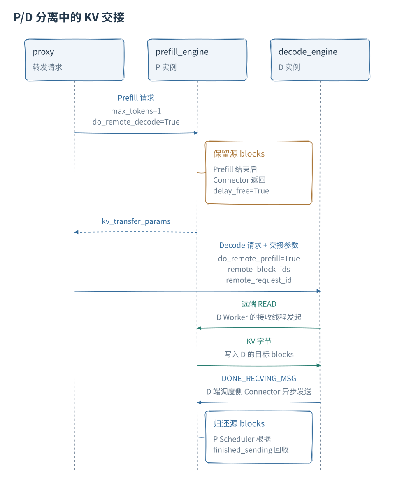
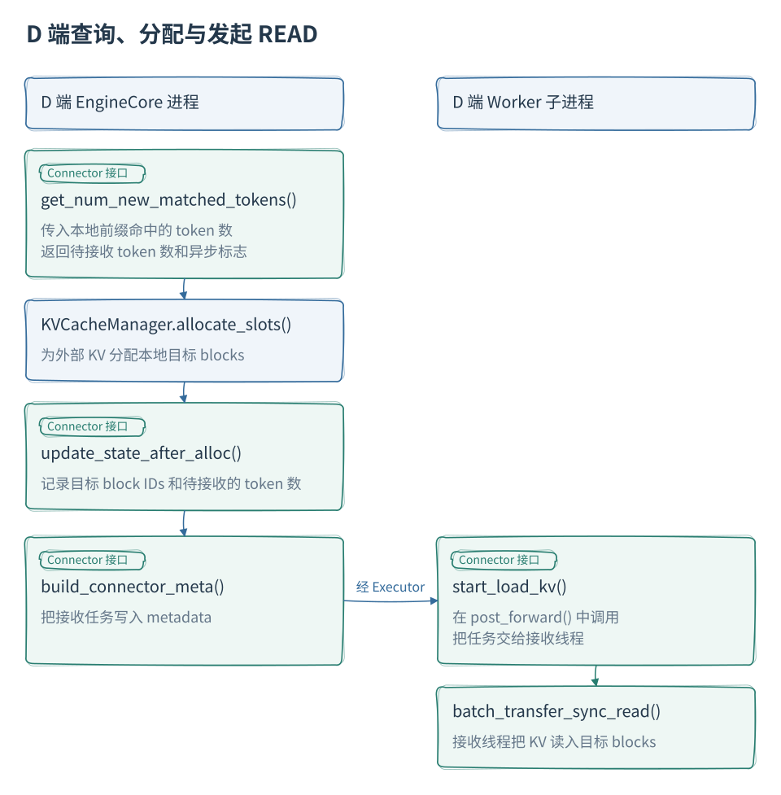
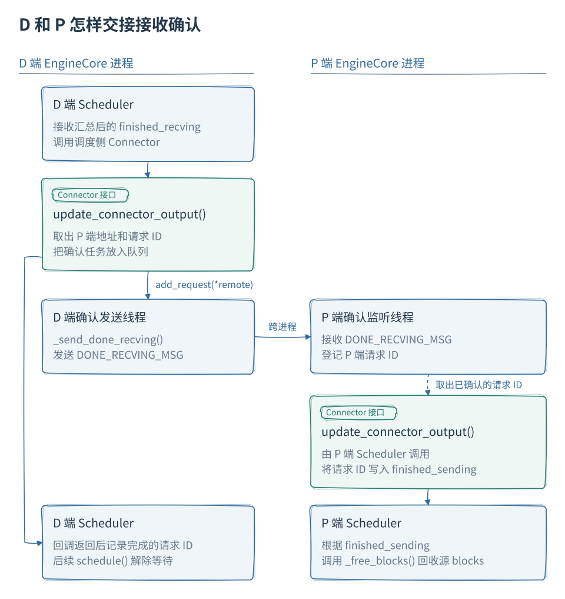

# vLLM 请求调度（三）：P/D 分离中的 KV 交接

以 `MooncakePullConnector` 为例，D 端 Worker 向 P 发起 READ，把 KV 读入本地 blocks。[`MooncakePullConnector`](https://github.com/vllm-project/vllm-ascend/blob/v0.30.0/vllm_ascend/distributed/kv_transfer/kv_p2p/mooncake/connector.py#L237-L251)

P 端算完 prompt 后，proxy 把 `kv_transfer_params` 随请求转给 D。D 的接收线程据此找到 P 的源 blocks。接收结束后，D 的调度侧 Connector 再通知 P 归还这些 blocks。



## request_finished_all_groups：P 端留下源 blocks

proxy 发给 P 的请求带有 `max_tokens=1` 和 `do_remote_decode=True`。P 生成第一个 token 后，请求达到长度上限，Scheduler 调用 `request_finished_all_groups()`。这个接口将各缓存组的 block IDs 交给 `MooncakePullConnectorScheduler.request_finished()`。[`build_prefill_request()`](https://github.com/vllm-project/vllm-ascend/blob/v0.30.0/examples/disaggregated_prefill_v1/load_balance_proxy_server_example.py#L819-L835) · [`MooncakeBaseConnector.request_finished_all_groups()`](https://github.com/vllm-project/vllm-ascend/blob/v0.30.0/vllm_ascend/distributed/kv_transfer/kv_p2p/mooncake/connector.py#L146-L152)

有源 blocks 待交接时，Connector 返回 `delay_free_blocks=True`。Scheduler 先保留这些 blocks，并把下面的参数作为 `kv_transfer_params` 交给 proxy。`remote_block_ids` 指出 D 要读哪些块，`remote_request_id` 让 D 在回送确认时能指明 P 端的请求。[`MooncakePullConnectorScheduler.request_finished()`](https://github.com/vllm-project/vllm-ascend/blob/v0.30.0/vllm_ascend/distributed/kv_transfer/kv_p2p/mooncake/pull_scheduler.py#L685-L722) · [proxy 转交 `kv_transfer_params`](https://github.com/vllm-project/vllm-ascend/blob/v0.30.0/examples/disaggregated_prefill_v1/load_balance_proxy_server_example.py#L972-L975)

```python
return delay_free_blocks, {
    "do_remote_prefill": True,
    "do_remote_decode": False,
    "remote_block_ids": computed_block_ids,
    "remote_num_prompt_tokens": prompt_len,
    "remote_engine_id": self.engine_id,
    "remote_request_id": request.request_id,
    "remote_host": self.side_channel_host,
    "remote_port": self.side_channel_port,
    "last_token_id": request.output_token_ids[-1],
}
```

## start_load_kv：D 端提交异步接收

D 的 Scheduler 查完本地前缀，把命中的 token 数传给 Connector 的 `get_num_new_matched_tokens()`。请求带有 `do_remote_prefill=True` 时，Connector 用这个数算出还要从 P 读多少 KV。P 提供 512 个 prompt token 的 KV、D 命中前 128 个时，接口返回 `(384, True)`，表示异步接收剩余 384 个 token 对应的 KV。[`MooncakePullConnectorScheduler.get_num_new_matched_tokens()`](https://github.com/vllm-project/vllm-ascend/blob/v0.30.0/vllm_ascend/distributed/kv_transfer/kv_p2p/mooncake/pull_scheduler.py#L579-L596)



1. **分配目标 blocks。** `KVCacheManager.allocate_slots()` 成功后，Scheduler 调用 `update_state_after_alloc()`，把 D 上的目标 blocks 交给 Connector。这个请求随后进入 `WAITING_FOR_REMOTE_KVS`。[`Scheduler.schedule()`](https://github.com/vllm-project/vllm/blob/v0.30.0/vllm/v1/core/sched/scheduler.py#L1159-L1239) · [`MooncakePullConnectorScheduler.update_state_after_alloc()`](https://github.com/vllm-project/vllm-ascend/blob/v0.30.0/vllm_ascend/distributed/kv_transfer/kv_p2p/mooncake/pull_scheduler.py#L617-L637)
2. **把计划送到 Worker。** `build_connector_meta()` 把 P 的交接参数、D 的目标 block IDs 和要接收的 token 数写入 metadata，随 `SchedulerOutput` 发给 Worker。[`MooncakePullConnectorScheduler.build_connector_meta()`](https://github.com/vllm-project/vllm-ascend/blob/v0.30.0/vllm_ascend/distributed/kv_transfer/kv_p2p/mooncake/pull_scheduler.py#L650-L670)
3. **提交 READ。** Model Runner V2 绑定 metadata。`ActiveKVConnector.post_forward()` 调用 Worker 侧 Connector 的 `start_load_kv()`，由 `MooncakePullConnectorWorker` 将任务交给接收线程。当本轮没有 token 要算时，`no_forward()` 也会调用 `post_forward()`。[`ActiveKVConnector.post_forward()`](https://github.com/vllm-project/vllm/blob/v0.30.0/vllm/v1/worker/gpu/kv_connector.py#L100-L112) · [`ActiveKVConnector.no_forward()`](https://github.com/vllm-project/vllm/blob/v0.30.0/vllm/v1/worker/gpu/kv_connector.py#L125-L133) · [`MooncakePullConnectorWorker.start_load_kv()`](https://github.com/vllm-project/vllm-ascend/blob/v0.30.0/vllm_ascend/distributed/kv_transfer/kv_p2p/mooncake/pull_worker.py#L1588-L1600)

接收线程用 P 的传输地址和 D 的目标地址调用 Transfer Engine。`batch_transfer_sync_read()` 要等这次 READ 结束，D 的 Scheduler 在这期间仍可安排其他请求。等待 KV 的这个请求在接收完成后才恢复调度。[`MooncakePullRecvingThread._execute_tp_transfer_bucket()`](https://github.com/vllm-project/vllm-ascend/blob/v0.30.0/vllm_ascend/distributed/kv_transfer/kv_p2p/mooncake/pull_worker.py#L1384-L1415)

```python
ret = self.engine.batch_transfer_sync_read(session_id, src_list, dst_list, length_list)
```

## update_connector_output：D 端确认接收，P 端回收

D Worker 的 `get_transfer_results()` 返回本 rank 已结束的接收任务。D 的 `MultiprocExecutor` 在 EngineCore 进程里累计各 rank 的完成通知，等达到 Connector 要求的数量，再把请求 ID 放进交给 Scheduler 的 `finished_recving`。[`MooncakePullConnectorWorker.get_transfer_results()`](https://github.com/vllm-project/vllm-ascend/blob/v0.30.0/vllm_ascend/distributed/kv_transfer/kv_p2p/mooncake/pull_worker.py#L1602-L1608) · [`KVOutputAggregator.aggregate()`](https://github.com/vllm-project/vllm/blob/v0.30.0/vllm/distributed/kv_transfer/kv_connector/utils.py#L66-L121)



### D 端调度侧 Connector 提交接收确认

D 的 Scheduler 调用 `self.connector.update_connector_output()`。`MooncakePullConnectorScheduler` 用 D 端请求 ID 从 `_reqs_recv_info` 取出 P 的地址和请求 ID，再把确认任务放入发送队列。[`MooncakeBaseConnector.update_connector_output()`](https://github.com/vllm-project/vllm-ascend/blob/v0.30.0/vllm_ascend/distributed/kv_transfer/kv_p2p/mooncake/connector.py#L134-L136) · [`MooncakePullConnectorScheduler.update_connector_output()`](https://github.com/vllm-project/vllm-ascend/blob/v0.30.0/vllm_ascend/distributed/kv_transfer/kv_p2p/mooncake/pull_scheduler.py#L730-L735)

```python
for req_id in connector_output.finished_recving or ():
    remote = self._reqs_recv_info.pop(req_id, None)
    if remote is not None:
        # ...
        self._recving_thread.add_request(*remote)
```

D 端的 `MooncakeSchedulerRecvingThread` 从队列取出任务，在 `_send_done_recving()` 里发送 `(DONE_RECVING_MSG, request_id)`。这里的 `request_id` 是 P 端的请求 ID。[`MooncakeSchedulerRecvingThread._send_done_recving()`](https://github.com/vllm-project/vllm-ascend/blob/v0.30.0/vllm_ascend/distributed/kv_transfer/kv_p2p/mooncake/pull_scheduler.py#L474-L484)

### D 端 Scheduler 记录接收完成

确认任务入队后，回调返回到 vLLM 的 `Scheduler._update_from_kv_xfer_finished()`。Scheduler 遍历同一份 `finished_recving`，把仍在等 KV 的请求 ID 记入 `finished_recving_kv_req_ids`。[`Scheduler._update_from_kv_xfer_finished()`](https://github.com/vllm-project/vllm/blob/v0.30.0/vllm/v1/core/sched/scheduler.py#L3009-L3018)

```python
if self.connector is not None:
    self.connector.update_connector_output(kv_connector_output)

for req_id in kv_connector_output.finished_recving or ():
    # ...
    req = self.requests[req_id]
    if req.status == RequestStatus.WAITING_FOR_REMOTE_KVS:
        self.finished_recving_kv_req_ids.add(req_id)
```

后续 `schedule()` 轮到该请求时，`_try_promote_blocked_waiting_request()` 读到这条完成记录，再解除等待。[`Scheduler._try_promote_blocked_waiting_request()`](https://github.com/vllm-project/vllm/blob/v0.30.0/vllm/v1/core/sched/scheduler.py#L2962-L2977)

### P 端收到确认后回收源 blocks

P 端的 `MooncakeSchedulerSendingThread` 收到 `DONE_RECVING_MSG` 后记下请求 ID。调度侧 Connector 的 `update_connector_output()` 从监听线程取出这批 ID，写入 `finished_sending`。[P 端处理 `DONE_RECVING_MSG`](https://github.com/vllm-project/vllm-ascend/blob/v0.30.0/vllm_ascend/distributed/kv_transfer/kv_p2p/mooncake/pull_scheduler.py#L364-L377) · [`MooncakePullConnectorScheduler.update_connector_output()`](https://github.com/vllm-project/vllm-ascend/blob/v0.30.0/vllm_ascend/distributed/kv_transfer/kv_p2p/mooncake/pull_scheduler.py#L750-L759)

```python
finished_sending = (
    self._sending_thread.get_and_clear_finished_requests() if self._sending_thread is not None else set()
)
if finished_sending:
    # ...
    if connector_output.finished_sending is None:
        connector_output.finished_sending = finished_sending
    else:
        connector_output.finished_sending.update(finished_sending)
```

回调返回到 vLLM 的 `Scheduler._update_from_kv_xfer_finished()` 后，P 的 Scheduler 遍历同一个对象中的 `finished_sending`，调用 `_free_blocks(self.requests[req_id])` 回收源 blocks。[`Scheduler._update_from_kv_xfer_finished()`](https://github.com/vllm-project/vllm/blob/v0.30.0/vllm/v1/core/sched/scheduler.py#L3022-L3025)

接收失败时，D 根据配置重算缺失的 KV 或结束请求。D 仍会通知 P 这次接收已经结束。[`Scheduler.update_from_output()` 的加载失败处理](https://github.com/vllm-project/vllm/blob/v0.30.0/vllm/v1/core/sched/scheduler.py#L1902-L1916) · [D 端发送确认](https://github.com/vllm-project/vllm-ascend/blob/v0.30.0/vllm_ascend/distributed/kv_transfer/kv_p2p/mooncake/pull_scheduler.py#L724-L745)
