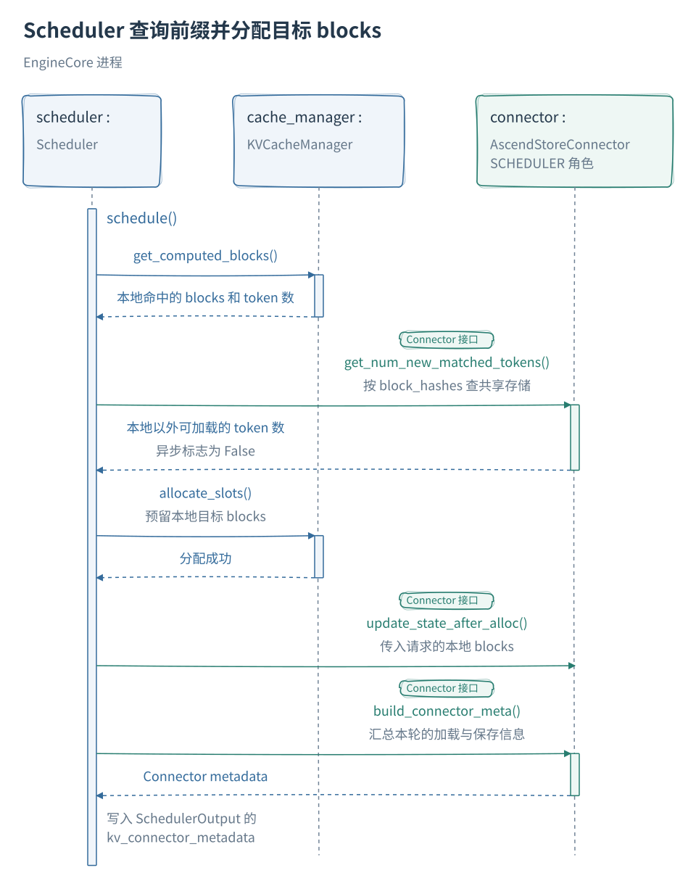
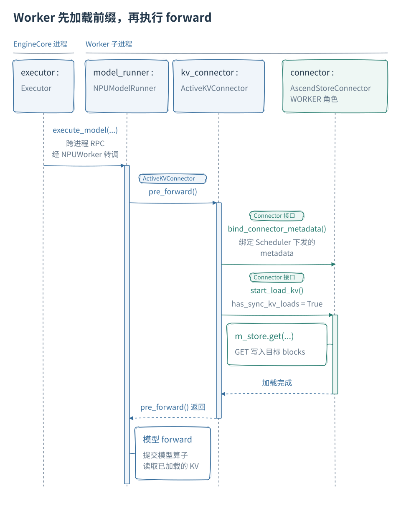
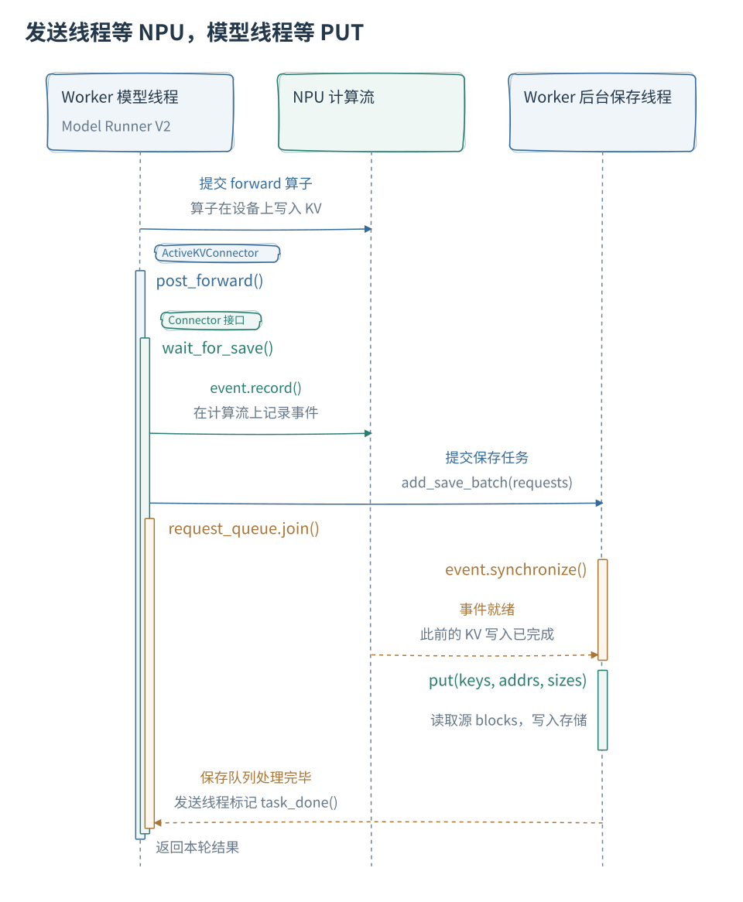
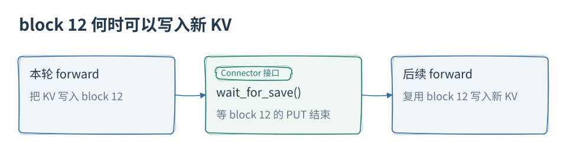

# vLLM 请求调度（四）：AscendStore 的 KV 保存与复用

这一节讨论 AscendStore 池化的非逐层模式（`use_layerwise=False`）。假设共享池里已有一段前缀 KV。Scheduler 先查能复用多少，Worker 再把命中的 KV 读入 NPU，执行 forward 后保存本轮可复用的 KV。下面以同步加载（`load_async=False`）为例。

## get_num_new_matched_tokens：Scheduler 查询前缀



Scheduler 先通过 `KVCacheManager` 查本地前缀，再把本地命中的 token 数传给调度侧 Connector。AscendStore 用请求的 `block_hashes` 查询共享池，返回**本地命中之外**还可以加载多少 token。 [`Scheduler._get_local_prefix_cache_hit(request)`](https://github.com/vllm-project/vllm/blob/v0.30.0/vllm/v1/core/sched/scheduler.py#L528-L538) · [`KVPoolScheduler.get_num_new_matched_tokens(request, num_computed_tokens)`](https://github.com/vllm-project/vllm-ascend/blob/0d2c9f7cea2d1c9ea8a5bf83a9fd1508abe416aa/vllm_ascend/distributed/kv_transfer/kv_pool/ascend_store/pool_scheduler.py#L614-L740)

池里命中的 KV 需要有地方写入。Scheduler 通过 `allocate_slots()` 分配本地 blocks，成功后才调用 `update_state_after_alloc()`，把这些 blocks 告诉 Connector。调度侧 Connector 最后用 `build_connector_meta()` 汇总本轮的加载和保存信息。 [`Scheduler.schedule(throttle_prefills)`](https://github.com/vllm-project/vllm/blob/v0.30.0/vllm/v1/core/sched/scheduler.py#L1158-L1191) · [`KVPoolScheduler.build_connector_meta(scheduler_output)`](https://github.com/vllm-project/vllm-ascend/blob/0d2c9f7cea2d1c9ea8a5bf83a9fd1508abe416aa/vllm_ascend/distributed/kv_transfer/kv_pool/ascend_store/pool_scheduler.py#L1020-L1094)

## start_load_kv：Worker 加载命中的 KV



多进程执行时，EngineCore 把 `SchedulerOutput` 交给 `MultiprocExecutor`。Executor 通过 RPC 把计划发给 `NPUWorker`，Worker 再调用本进程里的 Model Runner V2。[`EngineCore.step()`](https://github.com/vllm-project/vllm/blob/v0.30.0/vllm/v1/engine/core.py#L596-L602) · [`NPUWorker.execute_model(scheduler_output)`](https://github.com/vllm-project/vllm-ascend/blob/0d2c9f7cea2d1c9ea8a5bf83a9fd1508abe416aa/vllm_ascend/worker/worker.py#L774-L808)

前面生成的 metadata 就在 `SchedulerOutput.kv_connector_metadata` 里。其中的 `connector_metadata.requests` 是请求元数据列表，每条 `ReqMeta` 带着请求 ID、本地 block IDs 和加载、保存信息。 [`ReqMeta`](https://github.com/vllm-project/vllm-ascend/blob/0d2c9f7cea2d1c9ea8a5bf83a9fd1508abe416aa/vllm_ascend/distributed/kv_transfer/kv_pool/ascend_store/metadata.py#L998-L1014)

```python
class ReqMeta:
    req_id: str
    save_end_token: int
    # ...
    block_ids_by_group: list[list[int]]
    # ...
    save_start_token: int = 0
    can_save: bool | None = None
    load_spec: LoadSpec | None = None
```

`ActiveKVConnector.pre_forward()` 先绑定 metadata。因为这轮有同步加载（`has_sync_kv_loads=True`），它在 forward 前调用 Worker 侧 Connector 的 `start_load_kv()`。后端用 GET 把 KV 写进 Scheduler 分配好的本地 blocks。加载成功后，forward 可以直接读取这段前缀。 [`ActiveKVConnector.pre_forward(scheduler_output, **kwargs)`](https://github.com/vllm-project/vllm/blob/v0.30.0/vllm/v1/worker/gpu/kv_connector.py#L66-L91) · [`KVPoolWorker.start_load_kv(metadata)`](https://github.com/vllm-project/vllm-ascend/blob/0d2c9f7cea2d1c9ea8a5bf83a9fd1508abe416aa/vllm_ascend/distributed/kv_transfer/kv_pool/ascend_store/pool_worker.py#L1381-L1498)

## wait_for_save：Worker 保存 KV

本轮新算出的 KV 也可以存回共享池。Model Runner V2 在采样收尾时调用 `ActiveKVConnector.post_forward()`，Worker 侧的 `wait_for_save()` 在这里提交保存任务。 [`ActiveKVConnector.post_forward(finished_req_ids, wait_for_save=True)`](https://github.com/vllm-project/vllm/blob/v0.30.0/vllm/v1/worker/gpu/kv_connector.py#L100-L113) · [`AscendStoreConnector.wait_for_save()`](https://github.com/vllm-project/vllm-ascend/blob/0d2c9f7cea2d1c9ea8a5bf83a9fd1508abe416aa/vllm_ascend/distributed/kv_transfer/kv_pool/ascend_store/ascend_store_connector.py#L407-L416)



发送线程拿到任务时，NPU 可能还在写这一轮的 KV。模型线程在计算流上记录一个 event，流执行完这些写入才会到达它。同一轮的保存任务共用这个 event。 [`KVPoolWorker.wait_for_save(connector_metadata)`](https://github.com/vllm-project/vllm-ascend/blob/0d2c9f7cea2d1c9ea8a5bf83a9fd1508abe416aa/vllm_ascend/distributed/kv_transfer/kv_pool/ascend_store/pool_worker.py#L3283-L3307)

```python
current_event = None
# ...
send_thread = self.kv_send_thread
requests: list[ReqMeta] = []

for request in connector_metadata.requests:
    can_save = request.can_save
    if can_save is None or not can_save:
        continue
    if current_event is None:
        current_event = torch.npu.Event()
        current_event.record()
    # ...
    request.current_event = current_event
    requests.append(request)

# ...
if requests:
    self._previous_save_batch = send_thread.add_save_batch(requests)
send_thread.request_queue.join()
```

发送线程等 NPU 执行到这个 event，再从设备 blocks 读出 KV，写入共享存储。 [`KVCacheStoreSendingThread._handle_stored_request(req_meta)`](https://github.com/vllm-project/vllm-ascend/blob/0d2c9f7cea2d1c9ea8a5bf83a9fd1508abe416aa/vllm_ascend/distributed/kv_transfer/kv_pool/ascend_store/kv_transfer.py#L1229-L1232)

```python
if current_event is not None:
    current_event.synchronize()
if self.m_store.put(keys, addrs, sizes) is False:
    return
```

一项保存任务处理完，发送线程就在 `_handle_request()` 的 `finally` 中调用 `task_done()`。队列里的任务全部处理完后，模型线程的 `request_queue.join()` 才返回。 [`KVCacheStoreSendingThread._handle_request(req_meta)`](https://github.com/vllm-project/vllm-ascend/blob/0d2c9f7cea2d1c9ea8a5bf83a9fd1508abe416aa/vllm_ascend/distributed/kv_transfer/kv_pool/ascend_store/kv_transfer.py#L1046-L1064)

### 为什么要调用 `request_queue.join()`

PUT 直接从设备 blocks 读取 KV。假如本轮要保存 block 12，后续 forward 却先把新 KV 写进同一个 block，发送线程就可能把新 KV 存到旧前缀的 key 下。这就是模型线程要等保存队列处理完的原因。


